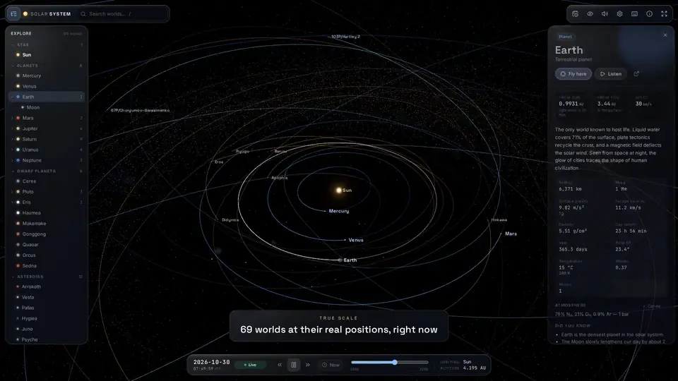

## **What is Solar System Engine**

Fly from the Sun's fire to the frozen edge of the Oort cloud, with every world where it really is right now. Solar System Engine is a true-scale, real-time model of the Solar System that runs in the browser. Every planet, major moon, dwarf planet and famous comet sits at its real position for any date between 1800 and 2200, wrapped in spacecraft surface maps, lit by a physically placed Sun and paired with the sound of each world.

It is a ground-up remake of the original 2021 Unity game, rebuilt on WebGPU with a glass interface and far more to explore.

> **Try it here:** this site's [Arcade](#/arcade/orrery) has the Orrery, a small pure-code cousin drawn in canvas with no image files. Click a world to fly in and drag to spin it. The Orrery is hand-tuned to stay readable; Solar System Engine is the true-scale one.

## **Exploring**

Click any world to open a glass panel with live distance, speed and light-time, physical data, discovery history, missions and facts. Search flies you anywhere, and time runs forwards or backwards across four centuries.

- **69 worlds:** the Sun, 8 planets, 31 moons, 9 dwarf planets, 12 asteroids and Kuiper belt objects, and 8 comets.
- **True scale, no tricks:** distances, sizes and orbits are real. A floating-origin camera with 64-bit positions lets you skim 20 km above an asteroid, then pull back to see the whole Kuiper belt.
- **Real positions for any date:** JPL planetary elements and Horizons orbits put every body where it is today, or where it was when Voyager 2 reached Neptune. Moons are tidally locked and planets spin on IAU pole models.
- **Time travel:** scrub from 1800 to 2200 or jump to one of 21 events: Apollo 11, Shoemaker–Levy 9, New Horizons at Pluto, the 2029 Apophis flyby, Halley's 2061 return.
- **The sky:** 8,355 real stars from the Yale Bright Star Catalogue, the Milky Way, the asteroid belt, Jupiter's Trojans, the Kuiper belt and the Oort cloud.

## **Hear Every World**

The original game's soundtrack returns, with its 9 original world sounds, NASA Juno recordings of Europa and Ganymede, and 58 live sonifications synthesised in the browser from each body's size, spin and temperature.

## **Technical Foundation**

- **Rendering:** three.js `WebGPURenderer` with TSL node materials and an automatic WebGL 2 fallback. Atmospheric scattering, city lights on the night side, cloud layers, ring shadows on Saturn, procedural surfaces for unmapped worlds, comet ion and dust tails, bloom and lens flare.
- **Coordinates:** bodies are positioned in heliocentric J2000 ecliptic kilometres in float64 on the CPU. Each frame the camera sits at the origin and everything is placed relative to it, so the GPU's float32 never sees a large number. A logarithmic depth buffer spans 1 m to 100 light-years.
- **Belts on the GPU:** 95,000 particles for the main belt, the Trojans, the Kuiper belt and the Oort cloud solve Kepler's equation per vertex, with Kirkwood gaps in the main belt.
- **Accuracy:** planet positions are good to well under a degree from 1800 to 2050. Moons and small bodies drift the further a date is from 2026, because two-body orbits ignore planetary perturbations.
- **Interface and audio:** Svelte 5 for the glass UI; the Web Audio API for the streamed soundtrack, spacecraft recordings, real-time sonification and convolution reverb.
- **Pipeline:** everything runs in Docker, from the asset and JPL Horizons scripts to the tests. Every push to `main` builds and tests, then ships to itch.io with butler and to GitHub Pages. The media kit and trailer are captured from the live app.

## **Credits**

- **Remake:** Echo Yin, with the original music and sounds from *Solar System* (2021).
- **Surface maps:** Solar System Scope (CC BY 4.0), NASA/JPL/USGS (public domain) and Askaniy (CC BY-SA 3.0).
- **Recordings:** NASA Juno Waves (NASA/JPL-Caltech/SwRI/University of Iowa).
- **Data:** JPL Horizons and Standish planetary elements, IAU WGCCRE rotation models and the Yale Bright Star Catalogue.
- **Licence:** code under PolyForm Noncommercial 1.0.0; third-party maps, recordings and data keep their own licences.
